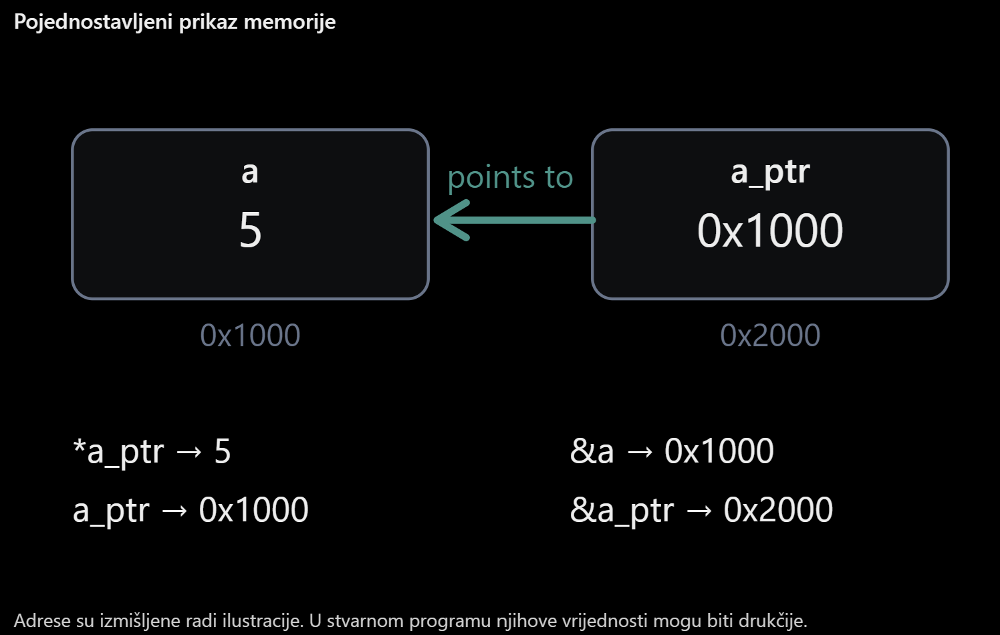

# 03 — Pointers

## 1. Cilj

Razumjeti što je pokazivač, kako se dobiva adresa varijable operatorom `&`, kako se pristupa vrijednosti operatorom `*` te razlikovati **adresu varijable**, **adresu spremljenu u pokazivaču** i **adresu samog pokazivača**. Promijeniti vrijednost varijable preko pokazivača.

## 2. Novi pojmovi

| Pojam | Značenje |
|---|---|
| **Pokazivač (`pointer`)** | Varijabla čija je vrijednost adresa drugog objekta. |
| **`&a`** | Adresni operator: daje adresu varijable `a`. |
| **`int *a_ptr`** | Deklaracija pokazivača na `int`. |
| **`a_ptr`** | Vrijednost pokazivača: adresa na koju pokazuje. |
| **`*a_ptr`** | Dereferenciranje: pristup vrijednosti na adresi spremljenoj u pokazivaču. |
| **`&a_ptr`** | Adresa same varijable pokazivača. |
| **`%p`** | Format za ispis adrese, uz argument odgovarajuće pretvoren u `void *`. |

**Važno:** znak `*` ima različitu ulogu u deklaraciji (`int *a_ptr`) i izrazu (`*a_ptr`). Pokazivač se smije dereferencirati samo kada pokazuje na valjan objekt.

## 3. Struktura projekta

```text
03_pointers/
├── CMakeLists.txt
├── prj.conf
├── README.md
├── images/
│   └── pointer_memory.png
└── src/
    └── main.c
```

`CMakeLists.txt` uključuje `src/main.c` naredbom `target_sources(app PRIVATE src/main.c)`. U `prj.conf` uključeni su `CONFIG_CONSOLE=y` i `CONFIG_PRINTK=y`. 

## 4. Pokazivači u C programu

U `src/main.c` koristimo lokalnu varijablu i pokazivač na nju:

```c
int a = 5;
int *a_ptr = &a;
```

Ispisom adresa provjeravamo na što pokazivač pokazuje:

```c
printk("Address of a: %p\n", (void *)&a);
printk("Value through pointer: %d\n", *a_ptr);
printk("Address stored in a_ptr: %p\n", (void *)a_ptr);
printk("Address of a_ptr: %p\n", (void *)&a_ptr);
```

**`&a` i `a_ptr` predstavljaju istu adresu**, a `&a_ptr` adresu samog pokazivača i u pravilu je drukčija. Prikazane adrese ovise o izvođenju programa.

### Pojednostavljeni prikaz memorije



*Slika je izvorni priloženi prikaz, bez izmjena. Adrese `0x1000` i `0x2000` ilustrativne su, nisu očekivane stvarne adrese ESP32-a.*

Na kraju mijenjamo vrijednost preko pokazivača:

```c
*a_ptr = 10;
printk("Updated value of a: %d\n", a);
```

Time se mijenja **varijabla `a`**, a ne adresa spremljena u `a_ptr`.

## 5. Izgradnja i provjera

Iz direktorija `zephyr_workspace` u PowerShellu, uz aktivno Zephyrovo razvojno okruženje:

```powershell
west build -b esp32_devkitc/esp32/procpu zephyr_course/02_c_fundamentals/03_pointers -d zephyr_course/02_c_fundamentals/03_pointers/build -p always
west flash -d zephyr_course/02_c_fundamentals/03_pointers/build
```

Očekivani **aplikacijski** ispis (stvarne adrese razlikovat će se od primjera):

```text
Pointers
Value of a: 5
Address of a: 0x...
Value through pointer: 5
Address stored in a_ptr: 0x...
Address of a_ptr: 0x...
Updated value of a: 10
```

Usporedi vrijednosti ispisane iza `Address of a` i `Address stored in a_ptr`: trebale bi biti jednake. `Address of a_ptr` prikazuje drugo mjesto u memoriji. Ovisno o konfiguraciji ispisa, format prikazane adrese može se razlikovati.

## 6. Zadaci

**A — Promjena vrijednosti.** Promijeni početnu vrijednost `a` na `15`, a zatim je preko `*a_ptr` postavi na `30`. Provjeri oba ispisa.

**B — Usporedba adresa.** Usporedi `&a`, `a_ptr` i `&a_ptr`. Objasni zašto su prve dvije adrese jednake, a treća različita.

**C — Promjena kroz pokazivač.** Nakon `*a_ptr = 10` ispiši i `*a_ptr`. Usporedi ispis s vrijednošću `a`.

**D — Drugi pokazivač.** Dodaj `int *second_ptr = &a;`. Promijeni vrijednost preko `*second_ptr` i provjeri što ispisuje `*a_ptr`.

**E — Sigurnost pokazivača.** Deklariraj `int *empty_ptr = NULL;` (dodaj `#include <stddef.h>`). Provjeri uvjetom `if (empty_ptr != NULL)` je li ga sigurno dereferencirati. **Nemoj** dereferencirati `NULL`.

Nakon zadataka vrati početne vrijednosti.

## 7. Pitanja

1. Što je pokazivač i koju vrstu podatka pohranjuje?
2. Što znači `int *a_ptr = &a;`?
3. Koja je razlika između `a`, `&a`, `a_ptr`, `*a_ptr` i `&a_ptr`?
4. Zašto ispis `&a` i `a_ptr` prikazuje istu adresu?
5. Koju adresu prikazuje `&a_ptr`?
6. Što se događa nakon naredbe `*a_ptr = 10;`?
7. Zašto se za ispis adresa koristi `%p` i pretvorba u `void *`?
8. Zašto nije sigurno dereferencirati pokazivač koji je `NULL`?

## 8. Zaključak

Pokazivač sadrži adresu objekta. Operator `&` dohvaća adresu, a operator `*` omogućuje čitanje ili promjenu vrijednosti na toj adresi. **`a_ptr` i `&a_ptr` nisu isto**: prvi predstavlja adresu objekta na koji pokazuje, a drugi adresu samog pokazivača.
