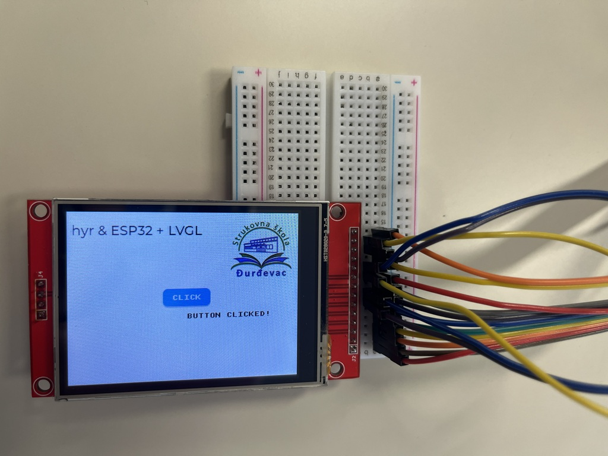

# ILI9341 TFT + XPT2046 Touch + LVGL



*Fotografija demonstracije. Budući da je naslov pomičan, na fotografiji može biti vidljiv samo njegov dio.*

## 1. Opis

U ovom projektu **Zephyrovi SPI, Display i Input driveri** povezuju ESP32 DevKitC V4 s ILI9341 TFT zaslonom i XPT2046 touch kontrolerom, dok **LVGL** omogućuje izradu interaktivnog grafičkog sučelja. Projekt pokazuje povezivanje hardverske konfiguracije, obrade dodira i vremenskog upravljanja u jednoj embedded aplikaciji.

Aplikacija prikazuje bijelu pozadinu, logotip škole, pomični naslov i gumb **CLICK**. Dodirom gumba pojavljuje se poruka `BUTTON CLICKED!`, koja nestaje pet sekundi nakon posljednjeg klika.

**Razvojna konfiguracija:** ESP32 DevKitC V4 (klasični ESP32), **Zephyr RTOS v4.4.2** i LVGL integriran kroz Zephyrove module. Ciljna oznaka pločice je `esp32_devkitc/esp32/procpu`.

Projekt koristi **LVGL 9 API**, primjerice `lv_screen_active()`, `lv_button_create()` i `lv_image_create()`. Uz standardnu Zephyrovu automatsku inicijalizaciju LVGL-a nije potrebno ponovno pozivati `lv_init()` u `main()`.

**Struktura projekta:**

```text
03_ili9341_xpt2046_lvgl/
├── src/
│   ├── main.c
│   ├── logo.c
│   └── logo.h
├── images/
│   └── demo.jpg
├── app.overlay
├── prj.conf
├── CMakeLists.txt
├── sample.yaml
└── README.md
```

Datoteka `app.overlay` opisuje hardver, `prj.conf` uključuje potrebne Zephyrove i LVGL mogućnosti, a `src/main.c` izrađuje korisničko sučelje. Datoteke `logo.c` i `logo.h` sadrže podatke za prikaz logotipa. `sample.yaml` nije potreban za običan `west build`.

## 2. Hardversko povezivanje

**ILI9341 TFT zaslon:**

| TFT pin | ESP32 DevKitC V4 | Namjena |
|---|---|---|
| `VCC` | `3V3` | Napajanje modula, prema specifikaciji konkretnog zaslona |
| `GND` | `GND` | Zajednička masa |
| `SCK` | `GPIO18` | SPI takt |
| `MOSI` / `SDI` | `GPIO23` | SPI podaci prema zaslonu |
| `CS` | `GPIO5` | Odabir zaslona |
| `DC` | `GPIO21` | Odabir naredbe i podataka |
| `RST` | `GPIO22` | Reset kontrolera |
| `LED` | `3V3` | Pozadinsko osvjetljenje na korištenom modulu |

**XPT2046 touch kontroler:**

| Touch pin | ESP32 DevKitC V4 | Namjena |
|---|---|---|
| `T_CLK` | `GPIO18` | Zajednički SPI takt |
| `T_DIN` | `GPIO23` | SPI MOSI |
| `T_DO` | `GPIO19` | SPI MISO |
| `T_CS` | `GPIO4` | Odabir touch kontrolera |
| `T_IRQ` | `GPIO25` | Signal dodira / prekid |

**Važno:** ILI9341 i XPT2046 dijele SPI signale `SCK` i `MOSI`, ali svaki ima vlastiti `CS`. Oznake pinova mogu se razlikovati među TFT modulima, pa prije spajanja provjeri oznake na svojoj pločici. GPIO pinovi ESP32 koriste **3,3 V logičke razine** i ne smiju se izravno spajati na 5 V.

## 3. Devicetree i driveri

U datoteci `app.overlay` čvor ILI9341 opisuje zaslon povezan preko SPI sabirnice, a čvor XPT2046 opisuje touch kontroler na istoj sabirnici, s drugim `CS` pinom.

Svojstvo `zephyr,display` odabire ILI9341 kao zaslon aplikacije. Čvor s kompatibilnošću `zephyr,lvgl-pointer-input` povezuje Zephyrov Input podsustav s LVGL-om, tako da se dodiri obrađuju kao LVGL događaji.

Fizička rezolucija zaslona iznosi **240 × 320 piksela**, a za vodoravni prikaz koristi se rotacija od **90°**. Projekt koristi konfiguraciju `app.overlay` provjerenu s navedenom verzijom Zephyra. Ako se pojavi zrcaljenje prikaza, najprije provjeri verziju Zephyrova ILI9341 drivera i postavke orijentacije; različite razvojne revizije nemaju nužno iste mogućnosti konfiguracije.

Kalibracija XPT2046 ovisi o konkretnom zaslonu. Nakon promjene rotacije ili koordinata provjeri dodir na više mjesta, uključujući rubove i kutove zaslona.

## 4. LVGL sučelje

Aplikacija dohvaća zaslon pomoću `DEVICE_DT_GET(DT_CHOSEN(zephyr_display))`, provjerava spremnost uređaja funkcijom `device_is_ready()` te uključuje prikaz pozivom `display_blanking_off()`.

LVGL zatim izrađuje:

1. **Bijelu pozadinu** glavnog zaslona.
2. **Logotip škole** u gornjem desnom kutu.
3. **Pomični naslov** `Zephyr & ESP32 + LVGL + ILI9341`.
4. **Gumb** `CLICK` s callback funkcijom za događaj `LV_EVENT_CLICKED`.
5. **Poruku** `BUTTON CLICKED!` ispod gumba.

Nakon dodira gumba aplikacija prikazuje poruku i ponovno pokreće LVGL timer od **5000 ms**. Kad vrijeme istekne, poruka se skriva. Glavna petlja poziva `lv_timer_handler()` i `k_sleep(K_MSEC(10))` kako bi se obrađivali grafički zadaci i događaji.

## 5. Izgradnja i provjera

### Preduvjeti

- Postavljen Zephyr workspace i aktivirano Python virtualno okruženje `.venv`.
- **Zephyr RTOS v4.4.2** i odgovarajući Zephyr SDK.
- ESP32 DevKitC V4 i ispravno spojen TFT touch modul prema tablicama iz odjeljka 2.
- Sve datoteke projekta, uključujući `src/logo.c` i `src/logo.h`.

Za početnu instalaciju pogledaj [Instalacija Zephyra na Windowsima](../../../docs/INSTALLATION_WINDOWS.md).

### Izgradnja i flash

U PowerShellu s aktiviranim `.venv`, iz direktorija `zephyr_workspace`, pokreni:

```powershell
west build -b esp32_devkitc/esp32/procpu zephyr_course/14_projects/03_devices/03_ili9341_xpt2046_lvgl -d zephyr_course/14_projects/03_devices/03_ili9341_xpt2046_lvgl/build -p always

west flash -d zephyr_course/14_projects/03_devices/03_ili9341_xpt2046_lvgl/build
```

Ako se projekt nalazi na drugoj lokaciji, prilagodi putanje. Prije flashanja zatvori Serial Monitor ili drugi program koji koristi isti COM port.

**Očekivani rezultat:** na zaslonu se pojavljuju logotip škole, pomični naslov i gumb `CLICK`. Dodirom gumba pojavljuje se `BUTTON CLICKED!`, a poruka nestaje pet sekundi nakon posljednjeg klika.

### Ako nešto ne radi

| Simptom | Što provjeriti |
|---|---|
| Zaslon je prazan | Napajanje i pozadinsko osvjetljenje, `CS` / `DC` / `RST` pinove, `prj.conf` te spremnost display uređaja. |
| Tekst je zrcaljen | Točnu verziju Zephyra, priloženi `app.overlay` i orijentaciju ILI9341 kontrolera. |
| Touch ne reagira | `T_DO` (GPIO19), `T_CS` (GPIO4), `T_IRQ` (GPIO25), XPT2046 driver i LVGL input čvor. |
| Dodir je pomaknut | Kalibraciju te orijentaciju koordinata XPT2046; provjeri rubove i kutove zaslona. |
| Slika ili boje nisu dobre | Format slike u `logo.c`, kompatibilnost s LVGL-om 9, RGB565 i zamjenu bajtova. |
| Greška pri konfiguraciji | Prvu konkretnu CMake, Devicetree ili Kconfig pogrešku u logu, a ne samo završnu poruku `Configuring incomplete`. |
| Greška pri prevođenju logotipa | Je li `src/logo.c` naveden u `CMakeLists.txt` te jesu li slikovni podaci kompatibilni s korištenim LVGL-om. |

Direktorij `build/` s generiranim datotekama **ne dodaje se u Git repozitorij**.
